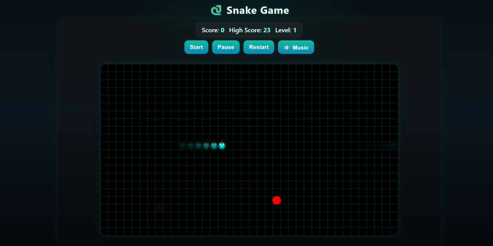

# 🐍 Classic Snake Game

A fun and interactive Snake Game developed using HTML, CSS, and JavaScript. Control the snake, collect food, and try to achieve a high score!

## 🚀 Features

- 🐍 Classic snake gameplay
- 🎮 Keyboard controls
- 🔊 Background music and game-over sound effects
- 🎨 Simple and user-friendly interface
- 💻 Runs in a web browser

🛠️ Skills Used
HTML5 CSS3 VS Code GitHub

## 📂 Project Structure

```text
snake-game/
├── .vscode/
├── .gitignore
├── bg.mp3
├── index.html
├── over.mp3
├── script.js
├── style.css
└── README.md
```

## 📸 Project Preview




## 🎮 How to Play

1. Open the game in your browser.
2. Use the arrow keys to control the snake.
3. Collect food to increase your score.
4. Avoid hitting the walls or your own body.
5. Try to achieve your highest score!

## ⚙️ How to Run

1. Clone this repository:

   ```bash
   git clone https://github.com/pravallika120/snake-game-.git
   ```

2. Open the project folder in VS Code or any code editor.
3. Open `index.html` in your browser.
4. Start playing and enjoy the game! 🎉

## 🌐 Live Demo

Play the game online without downloading the code:

[🎮 Click here to play Snake Game](https://pravallika120.github.io/snake-game-/)


## 💡 What I Learned

- Writing game logic using JavaScript
- Handling keyboard events
- Applying CSS styles to a web project
- Working with audio files
- Managing project files using GitHub

## 🔮 Future Improvements

- Add different difficulty levels
- Save the highest score
- Add mobile touch controls
- Improve the game design and animations

## 👩‍💻 Author

**Pravallika Chaganti**

Aspiring Software Developer | HTML • CSS • JavaScript

---

⭐ Thank you for visiting my project!
